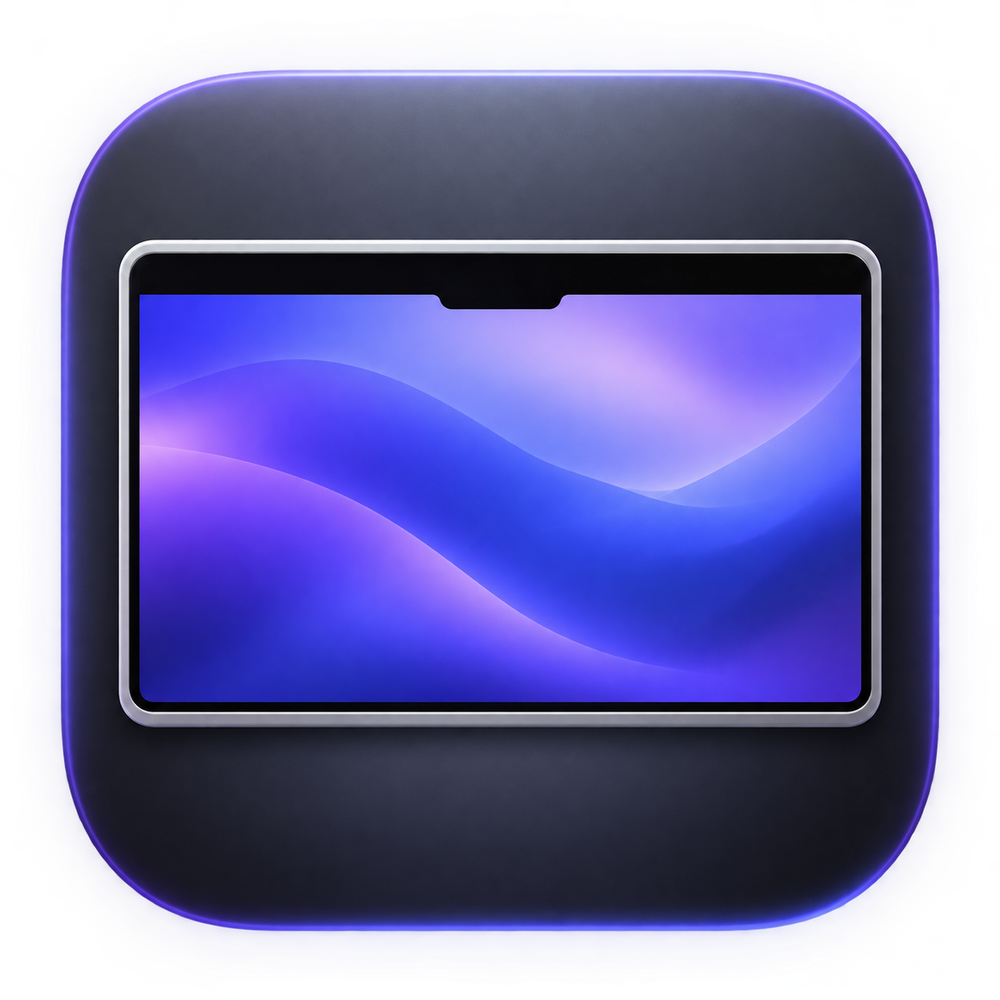

<p align="center"></p>

# NotchShade

A lightweight native macOS menu bar app that blends the camera notch into a black strip across the top of your screen. The camera remains usable.

## Download and install

[Download NotchShade 1.4 for Apple Silicon](Downloads/NotchShade-1.4.zip?raw=true).

Unzip, move NotchShade.app to Applications, and open it. Use its rectangle icon in the menu bar to enable the strip or adjust its height. Quit and replace any older copy before installing an update.

Requires an Apple Silicon Mac running macOS 13 or newer. The app is locally signed, not Apple-notarized. If macOS blocks it, review the source, then use System Settings → Privacy & Security → Open Anyway for this app.

## Features

- Automatic notch detection and display-change handling.
- Automatic strip height includes one extra point for coverage.
- Optional additional height and support for displays without a notch.
- Click-through overlay with support for Spaces and fullscreen auxiliary windows.
- Persistent preferences and a custom app icon.
- No network code, camera access, Accessibility permission, or screen recording permission.

To launch at login, add the installed app in System Settings → General → Login Items & Extensions → Open at Login.

## Live wallpapers and icon contrast

NotchShade draws an independent overlay rather than changing your wallpaper. Ordinary live wallpaper windows should remain underneath it. Compatibility with WallpaperMachine is not guaranteed for every window mode.

macOS controls menu bar icon contrast. WallpaperMachine can set a still frame from its animation as the system wallpaper, overriding a dark base. In WallpaperMachine’s settings, turn off **Use the wallpaper as the macOS desktop picture** first. In Quick Settings, the switch is called **Desktop picture** (桌面图片). If the switch is disabled, check whether **Animate lock screen** is on. With desktop picture sync off, WallpaperMachine can keep playing the live wallpaper while Mission Control uses your system wallpaper.

Choose **Use Dark Base Wallpaper…** in NotchShade to remember your current wallpaper and set a black system wallpaper on the main display. You can also select **Black** under **System Settings → Wallpaper → Colors**. macOS can then use the dark system wallpaper when choosing icon contrast. NotchShade applies the change once when you ask, and macOS still controls the icon color.

To undo the change, switch back to the same desktop and choose **Restore Previous Wallpaper…**. The saved image and placement are restored. For dynamic wallpapers or shuffles, reselect the original mode in System Settings if needed. Restore before uninstalling if you want to keep the original image. The black system wallpaper can be visible when your live wallpaper pauses or closes.

## Build from source

Install Apple's Command Line Tools, then run:

```sh
bash build.sh
```

The build produces `build/NotchShade.zip` with a locally signed Apple Silicon app. No Xcode project or external dependencies are needed. The Swift source is in `Sources/main.swift`, with the app metadata and icon in `Resources/`.

## Validation

The build verifies the app signature. Test dark-base compatibility with your live wallpaper running and use the restore command if the result does not suit your setup.
